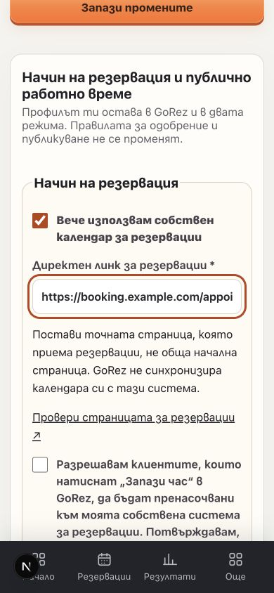
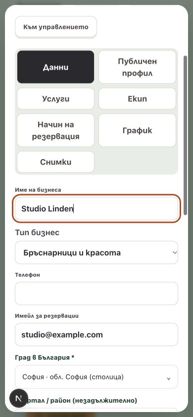

# GoRez Master Specification — review and release notes

Review branch: `codex/master-booking-dashboard`, based on default-branch commit `5135fdb`.

The implementation was initially prepared without production actions. **The owner subsequently explicitly approved the three Production migrations and publication on 2026-11-04.** See the release record in `operations/20261104-master-release.md` for actual applied/deployed status. The original working directories and their unrelated changes were preserved; implementation is in a separate Git worktree. No new paid services or Google/AI tests were approved or enabled.

**Released:** [PR #28](https://github.com/MetodiGG/AI-Receptionist/pull/28), application revision `4736f4a`, successful Production deployment and live HTTP/mobile/Safari smoke checks. The separately approved Vercel Hobby counter received the first QA page views; details, screenshots and honest remaining cloud/provider checks are in the operation record.

## Implemented

- Owner dashboard: phone-first labeled Home / Bookings / Results / More navigation, accessible native More dialog, publication/mode summary, safe-area spacing measured from the actual navigation height, compact settings section selector, readable controls, section save actions, draft warnings and guarded destructive actions. Desktop destinations remain available.
- Settings, admin detail forms and media editors: min-content-safe grids and wrapping; working hours, services, staff, photos, account and assistant sections remain reachable. Language changes retain service/profile/schedule drafts. Mode, public-profile and media saves prevent switching sections while saving.
- Explicit `gorez` / `external` partner booking modes. Existing businesses default to GoRez, without publication or calendar changes. The owner or platform admin saves consent, a specific HTTPS booking destination and independent seven-day public opening hours, with optional split shifts.
- Rich registration in both modes: website, descriptions, services, photos, optional team/bios, payment methods, brands and policies. External mode does not require staff, internal shifts or known prices/durations. No placeholder staff or calendar rows are inserted. Internal mode retains mandatory service and schedule validation.
- External-mode publication has conditional SQL readiness checks. Returning to internal mode requires valid internal setup. Mode switches with upcoming appointments require acknowledgement, and preserve all existing appointments, staff and working hours.
- Public profile, partner directory and both search-card layouts use server-resolved first-party POST booking actions for external partners. Profiles remain browsable. Internal slots/chat/new bookings are disabled in both UI and API/SQL; an authenticated owner-only availability path preserves management of genuine historical appointments.
- First-party anonymous profile-view and outbound-click counts, separate from confirmed internal bookings. No conversion claims or invented customer counts. Visible-page views and user-initiated POST actions avoid API/prefetch counting; event UUIDs suppress replayed counts. Analytics outages do not block redirects.
- Separately owner-approved free Vercel Web Analytics (`@vercel/analytics` 2.0.1) for public Production visits. Tested allowlist strips all URL queries, drops private/unknown/token/fragment URLs and potentially personal referrers, respects DNT/GPC, and never sends paid custom events. Global strict-origin referrer headers prevent raw same-origin query leakage; private routes retain no-referrer. No SDK loading in local/Preview or on initial private pages. Updated bilingual privacy disclosure. Visitor estimates stay in Vercel, not mislabeled as bookings or inserted as invented GoRez statistics.
- Platform admin has a private Statistics tab with 7/30-day aggregate profile views, partner/non-partner referrals, GoRez bookings and currently published businesses, plus a link to the separate Vercel visitor dashboard. All count queries remain behind verified platform-admin authorization. No fabricated site-wide visitor number or unique-person estimate is shown.
- Google results: official attributed photo/lightbox widget preserved; documented `gmp-select` / `event.place.id` selects the exact result. A separate panel checks only GoRez-owned reviewed booking metadata. The original non-EEA custom-card path can also explicitly check for a verified link. No widget Shadow DOM scraping, image rehosting, new Details calls or billing-flag changes.
- Admin-only non-partner booking-link register: draft, separate human verification/approval, immutable exact Place ID, revision checks, evidence/source, reviewer/date, recheck, disable, public reports, audit and actual outbound-click counts. Approval expires after 90 days without a recheck; missing reviewer identity also makes the link unusable. Linked GoRez partner Place IDs cannot be approved or redirected as non-partners.
- `/faq?lang=bg` and `/faq?lang=en`: 28 client and 41 business questions, real bilingual answers, grouped accessible disclosures, keyboard tabs, question search, server-rendered answers, localized metadata/hreflang, sitemap and navigation/footer/onboarding/dashboard links. Business landing answers reuse the canonical FAQ. Privacy/terms distinguish external providers and anonymous referral measurements.
- Existing pricing, no-card signup, explicit paid-continuation consent, email-only notifications, approval roles, booking constraints and geographic/service relevance remain intact.

## Main implementation paths

| Area | Paths |
| --- | --- |
| Responsive dashboard | `app/dashboard-responsive.css`, `components/dashboard-shell.js`, `components/owner-context.js`, `app/dashboard/settings/page.js`, `hooks/use-unsaved-changes.js` |
| Mode/hours validation | `lib/booking-mode.mjs`, `lib/booking-settings.mjs`, `lib/outbound-network.mjs`, `components/business-booking-settings.js`, `components/booking-mode-fields.js`, `components/opening-hours-editor.js` |
| Registration | `components/business-setup.js`, `lib/business-application.mjs`, `app/api/public/business-applications/route.js` |
| Public booking/search | `lib/public-booking.js`, `lib/public-business-query.mjs`, `lib/public-directory.mjs`, `lib/discovery/internal-search.mjs`, `components/public-booking-page.js`, `components/business-profile.js`, `components/business-directory.js`, `components/discovery-search.js` |
| Outbound/analytics | `app/out/business/[slug]/route.js`, `app/out/place/[id]/route.js`, `lib/outbound-booking.mjs`, `components/outbound-booking-button.js`, `components/profile-view-tracker.js`, `components/referral-analytics.js`, owner analytics API, authenticated maintenance cron |
| External destinations | `lib/external-booking-links.mjs`, admin/public link APIs, public report API, `components/admin-external-booking-links.js`, `components/external-place-booking.js`, `components/google-discovery-list.js`, `lib/discovery/place-selection.mjs` |
| FAQ/SEO | `lib/faq.mjs`, `components/faq-page.js`, `app/faq/page.js`, `app/sitemap.js`, marketing/footer/landing/onboarding/legal components, mode-aware profile metadata |
| Offline verification | `tests/external-booking.test.mjs`, `tests/external-booking-database.test.mjs`, development-only fixtures under `app/dev/`, updated duration and staging-manifest assertions |

## Mobile diagnosis and evidence

The reported whole-document Safari shrink was **not reproduced on the audited current default branch**. The nine-tab rail measured about 1134 CSS px, but was already contained in an internally scrolling rail; document width equaled viewport width at all eight requested sizes. Tiny labels and the difficult horizontal section navigation were reproducible. The change therefore does not claim an unproven single root cause: it replaces the phone interaction and hardens grid/min-content boundaries without hiding body overflow or disabling zoom.

An additional 12 px *inside-dialog* overflow at 320 px was found during the new admin QA. Its cause was the three intrinsic-width statistics columns; minmax tracks and two phone columns resolve it.

Local browser measurements, real components with explicitly fictional development-only data:

| CSS width | Document width, settings | Settings panel width (rounded) | Document width, admin |
| ---: | ---: | ---: | ---: |
| 320 | 320 | 292 | 320 |
| 360 | 360 | 332 | 360 |
| 375 | 375 | 347 | 375 |
| 390 | 390 | 362 | 390 |
| 414 | 414 | 386 | 414 |
| 768 | 768 | 625 | 768 |
| 1024 | 1024 | 704 | 1024 |
| 1440 | 1440 | 1076 | 1440 |

- At 320 px all eleven settings sections were opened: no document overflow or visible panel descendants outside the viewport. Inputs/selects measured at least 16 px.
- Mobile navigation contains exactly four visible primary items. Opening More, pressing Escape and focus returning to More were verified.
- Save actions are in normal document flow at the beginning and end of supported settings sections; per-service/team actions remain beside each record. A floating sticky save bar was removed after QA found it could cover a focused field on a narrow screen.
- Business draft survived BG/EN switching; booking section warned before discarding its edits. URL draft survived the language switch.
- Admin cards tested at all eight widths, detail editor at all five phone widths; corrected 320 px dialog client width and scroll width both 300 px. Details, photos and verified-link management opened successfully.
- External public fixture at 390 px: two first-party outbound forms, no internal slot grid/chat or empty team section, honest unknown prices, full public hours.
- FAQ keyboard ArrowRight switched audience; Bulgarian question search filtered correctly. BG and EN each have all 69 answer disclosures in the server HTML, with locale-specific canonical and BG/EN/x-default alternates.
- Actual desktop Safari/WebKit was exercised locally, including four **Make Text Bigger** increments and focused form inputs. Normal size was restored and only the temporary local Safari tab was closed. Safari's Develop/Responsive Design tooling was not enabled; **this is not an actual iPhone/iOS device or a certified exact 200% phone-text test**. A physical iPhone check at 200% text size remains a release acceptance step.

Screenshots are local synthetic UI proof, not real clients or newly created businesses:





## Automated and HTTP checks

- `pnpm test`: **671 passed, 0 failed** (including existing search/ranking/booking regressions, platform-statistics authorization and Web Analytics privacy-filter tests).
- New unit coverage: both registration modes, omitted external staff/schedule/prices/durations, safe URLs, normalized IPv4/IPv6/DNS exclusions, permission/origin/rate limits, stale settings revisions, analytics fail-open behavior and replayed count IDs, disabled/expired/unverified destinations, provider selection boundaries and all bilingual FAQ entries.
- Actual local PostgreSQL-compatible PGlite integration: all three migrations execute; default/internal behavior, owner restrictions, SQL service values, external applications without staff/working hours, conditional admin publication, mode-switch acknowledgement, preservation of real fixture appointments/schedules, return to internal readiness, suspension retention, link approvals/revisions/RLS and referral summaries/pruning.
- Local Next HTTP checks: unauthenticated owner/admin mode settings, link admin, referral summary and existing-appointment availability all return 401. Outbound GET returns 405 without counting or redirecting. Cross-origin view POST returns 403; invalid application returns 422.
- `pnpm build`: successful production build.
- `pnpm audit --prod`: **0 known vulnerabilities**. An existing transitive Zod 4.1.11 under `@vercel/cli-config` was pinned to the project's already installed patched 4.6.6 via root `pnpm-workspace.yaml`. The separately approved Vercel Analytics SDK is the only new runtime dependency. Advisory: [GHSA-mrhx-c7xc-m3w5](https://github.com/advisories/GHSA-mrhx-c7xc-m3w5).
- `git diff --check`: clean. No lint script is configured in this repository.

## Database migrations — applied after separate owner approval

These three were applied in order within one guarded atomic transaction after explicit approval. Do not replay them in Production:

1. `20261104170000_external_booking_modes.sql`: mode/consent/hours, conditional service rules, protected settings RPC, insertion race guard and mode-aware moderation wrapper.
2. `20261104171000_external_business_applications.sql`: mode-aware atomic registration wrapper; original internal transaction retained as a non-client-executable helper.
3. `20261104172000_verified_booking_referrals.sql`: reviewed destinations, reports/audit, anonymous event storage, RLS, review/summary/maintenance RPCs.

They require the existing business-content/media migration and all earlier production migrations. They contain no seed businesses, publication backfill, calendar purge or real appointment changes. New RPCs are service-role-only; owner/admin identity is verified by the existing server auth boundary. Client roles cannot directly change protected booking settings or review non-partner links. Production's existing migration-history table was absent; application was through the owner-approved SQL console, with exact scripts and preservation checks recorded in the operation log.

`scripts/prepare-staging.mjs` lists these as **pending** only; its approved bootstrap allowlist is deliberately unchanged. Do not assume running the old bootstrap installs this feature.

### Future approved rollout checklist

1. Obtain separate approval for staging migrations/data testing and later for production migrations/deployment. Inspect target project ID, migration history, existing function signatures and backup/recovery readiness. Do not point a Preview build at Production service credentials.
2. Back up schema/data and current function definitions. Run the three migrations in order in the approved isolated staging database; register the versions through the normal migration workflow. Never rerun their function-renaming statements manually.
3. Use dedicated staging owner/admin accounts. Exercise registration, authenticated save/reload, external opt-in/out, concurrent revision conflicts, pending/suspended publication restrictions, existing appointment management, gallery upload and view/click summaries. Check existing internal booking, reminders/review invitations and account deletion still work.
4. On a real iPhone/Safari, verify widths, inputs, keyboard focus, More, photo picker, calendar, safe-area/browser bars and 200% text size. The local synthetic fixtures are development-only and return 404 in production mode.
5. With separate Google usage approval, test a documented selection on an actual UI Kit result. Verify correct Place ID association, official photo/lightbox/map/website actions, attribution and no booking CTA for an unapproved link. Do not turn on a Details API, increase a quota or alter billing flags for this test.
6. Admin personally verifies the official business association **and** actual appointment flow before approving any non-partner link. Recheck remote redirects manually; GoRez does not crawl booking sites or perform remote bookings. A saved draft is not approval.
7. Only after all staging gates and explicit production approval, apply schema **before** deploying this application revision: its select lists require the new columns. Existing old application code remains compatible with default GoRez rows during the migration-first window.
8. After the approved deployment, smoke-test internal and external paths with controlled accounts, inspect audit/maintenance failures and verify referral pruning runs through the existing authenticated notification cron. Existing email/billing/Google environment configuration stays unchanged.

### Rollback / incident handling

Do **not** drop the new columns/tables or rename functions back after real external-mode data exists; that would lose consent/evidence/history and could reopen the old internal booking UI for an external business. There is deliberately no automatic destructive down migration.

Before any external business is enabled, an application-only rollback to the old version is possible while retaining the additive schema. After external adoption, prefer a forward fix on this revision; disable individual bad non-partner links immediately through admin. Do not roll the application back to a version that does not understand external mode. Any emergency mode transition must retain existing data, satisfy internal readiness, acknowledge upcoming appointments and have owner/admin approval. Keep anonymized event/audit records according to the retention policy.

## Security/provider limitations and human decisions

- No new environment variables, secrets, paid services, AI calls or on-platform payments are required. Existing Supabase server credentials, verified-admin allowlist, rate limiting, cron auth and Google grants are reused. Do not expose server credentials to the browser.
- Destinations are HTTPS with bounded length, no credentials/tokens, IP literals, local/reserved hosts or common open-redirect parameters. All DNS answers must be public on save/approval **and navigation**. No remote page fetch/proxy or redirect following is performed, so there is no backend SSRF crawl. A third-party site can change later; explicit consent/manual verification, reporting, disabling and expiry remain necessary.
- A same-origin user-initiated POST is required to record referrals. GET/prefetch does not redirect or count. Counts are events, not unique people, bookings, customers or revenue. CTR is intentionally omitted because clicks can originate outside the profile and there is no meaningful shared denominator. No private owner URL is returned in the public profile JSON.
- Event retention is 90 days when the existing maintenance cron runs; resolved link reports are pruned after 90 days. Reports contain user-entered correction text, with an explicit request not to include personal data. Admin audit/evidence is private; do not paste personal information there.
- Google official references: [Advanced Place List](https://developers.google.com/maps/documentation/javascript/places-ui-kit/advanced-place-list), [widget reference / selection events](https://developers.google.com/maps/documentation/javascript/reference/places-widget). This implementation does not add a separately instantiated billable Details widget. The existing Advanced Place List still follows existing grants/budget controls. Actual provider rendering/availability and account-specific terms were **not live-tested** in this task.
- Neither mode synchronizes external calendars bidirectionally, reads third-party availability or confirms third-party reservations. Confirmed external-booking conversion tracking would require a separate authorized provider integration and privacy review, not inference from these clicks.

## Local review

```sh
pnpm install --frozen-lockfile
pnpm test
pnpm build
pnpm audit --prod
pnpm dev --port 3037
```

Development-only pages (no account/database writes): `/dev/dashboard`, `/dev/platform-admin`, `/dev/business-setup`, `/dev/business-profile?mode=external&lang=bg`. FAQ: `/faq?lang=bg` and `/faq?lang=en`.

The fixtures use the actual UI components but deliberately disable/short-circuit mutations. They do not prove authenticated cloud save/reload or provider behavior. Those gates require controlled account/provider checks. This document is not authorization for further deployments, migrations, paid calls or business-mode changes; see the separately approved operation record for the release performed in this task.
