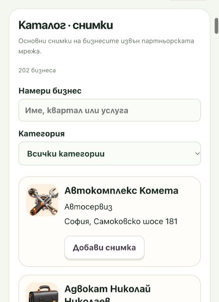
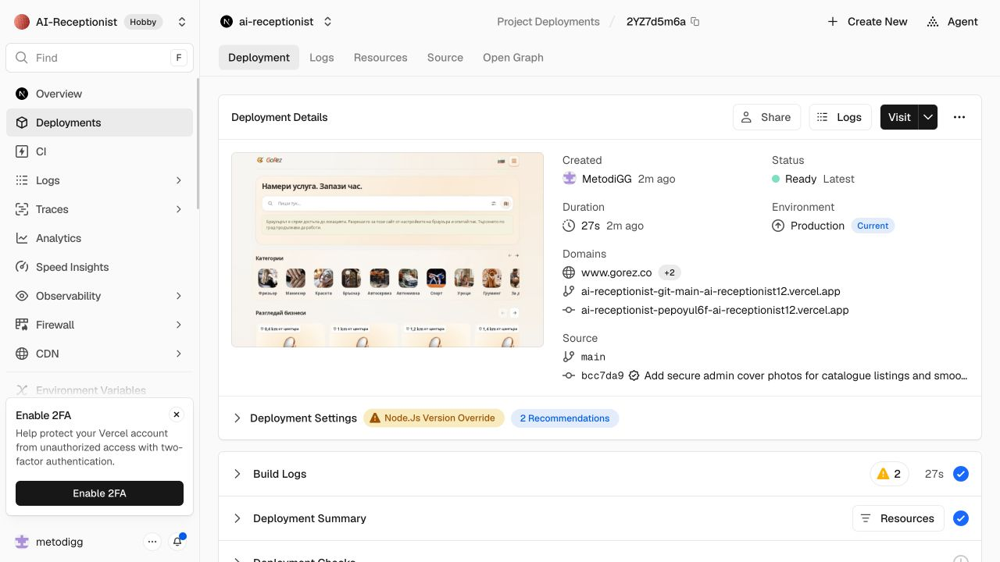

# Catalogue photos release — 6 November 2026

## Approval and database

Owner approval: apply only `20261106100000_catalogue_photos` to Production and
publish after tests; no paid plan or partner/customer/booking changes.

The authenticated Supabase SQL Editor target was
`ilpdtvbymxqgimrboyvh` / main. Preflight confirmed all three new table names and
both RPC names absent, and the existing `business-media` bucket private.

Reviewed migration SHA-256:
`8b1b2779ffd0a49717e84b93833b7b243e71a2d8fe8368e6dd65321029ffe2d1`.

Applied in a repeatable-read transaction with 3-second lock timeout and 30-second
statement timeout, an already-migrated guard, and temporary before/after content
digests for businesses, customers, appointments, services, staff, hours and
partner media. Digests matched. The temporary snapshot was dropped on commit;
it was not made accessible to browser roles. No baseline/bootstrap/history
schema was applied or created.

The SQL Editor returned `catalogue_photo_migration=applied`, `rls_tables=3`,
`catalogue_photos=0`. Existing counts remained 4 businesses, 10 customers and
1 appointment. Public/customer table and RPC denial checks passed inside the
same transaction. No real catalogue photo was uploaded for release QA.

## Verified publication

[PR #33](https://github.com/MetodiGG/AI-Receptionist/pull/33) passed its two GitHub
checks and was merged. Production commit
`bcc7da9d5b4c9b15d9f3ab9a3b1bf95af4259ddc` has exactly the tested application
tree from release branch commit `7c322c20a26329d9eba6b9ae1b102858901f5c6a`.

Vercel deployment
[2YZ7d5m6aVJB3iZPtKhgor8eoV5r](https://vercel.com/ai-receptionist12/ai-receptionist/2YZ7d5m6aVJB3iZPtKhgor8eoV5r)
was Ready / Latest / Production / Current for `www.gorez.co` and the expected
`main` commit. The owner personally signed in to the GoRez admin account; the
live **Каталог** section loaded **202 non-partner catalogue listings**, 40 on
the first admin page, and the fresh per-listing photo form opened successfully.
No real photo was uploaded and no permission receipt was fabricated. A first
live upload still requires a photograph the owner is authorised to publish.

Unauthenticated management access returned 401 with `private, no-store`; a
malformed image ID and the local-only development fixture both returned 404.
One read-only live manicure search returned HTTP 200, `externalStatus: catalogue`,
10 cards out of 16 eligible results and no Google plan. No provider call, actual
booking or test email was made. The existing production page size remains 10.

The additive private tables can safely remain if an application rollback is
needed. Local QA servers were stopped and temporary viewport overrides reset.

## Tests and UI

- Full suite: 879 passed, 0 failed. Production build and diff whitespace check
  passed. No dependencies or environment values changed.
- Local UI: large 25.8 MB synthetic JPEG prepared to 1024×683; upload, replacement,
  removal and fallback; permission gating; category filtering; debounced name
  search; BG/EN; 16 px form text and no horizontal overflow at 320 px viewport.
- The full sourced rail reaches 203 cards across bounded pages, stops exactly at
  `scrollLeft=max=59402`, and disables Next. Switching category resets to 0 and
  the auto-repair rail reaches its 17 real cards and stops. Desktop viewport and
  page width both 1280 px. Fixtures never submit appointments or provider calls.
- Admin upload/auth/validation/conflict tests and PGlite transaction/RLS tests
  cover real backend logic separately from the labelled browser-only fixture.

## Performance changes requested during this release

- Keep a single observer lifecycle per carousel. Observe actual child insertion,
  removal and resize; coalesce layout reads into one animation frame. Typing no
  longer re-registers observers across all previously loaded business cards.
- Memoise stable cards, matching rows and distance origins so unrelated typing
  does not recompute every card. Actual filters, coordinates, locale, photos and
  result changes still update the UI. No availability cache or stale slot path
  was introduced.
- Defer the legacy Google list renderer until a real server-approved plan needs
  it. Catalogue browsing does not load that component's code or call Google.
- Built homepage application-entry scripts: 331,887 → 325,437 uncompressed bytes;
  103,040 → 101,355 individually gzip-compressed bytes. These are build-manifest
  entry chunks, not an entire page-transfer or field Core Web Vitals claim.
  Observer tests coalesce 100 resize/mutation notifications into one scheduled
  measurement and verify exact append/removal cleanup and unmount cancellation.

There is no claim of zero latency: device speed, permission prompts, network and
live database latency still apply. No paid plan, provider quota or booking logic
was changed to obtain these improvements.
