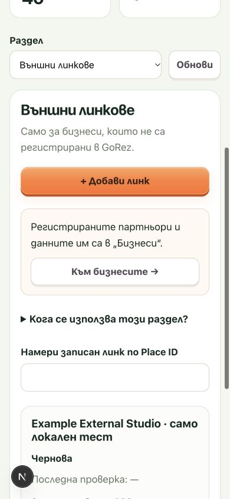
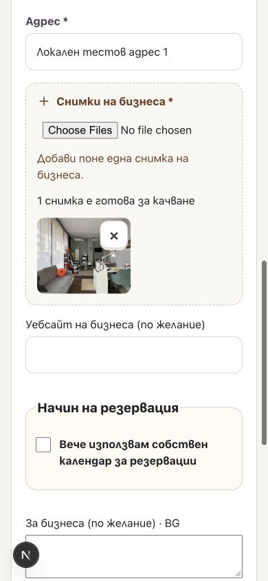

# Local follow-up: clearer admin and required registration photos

## Scope and release status

The owner explicitly requested **local preparation only**, not publication. These changes are on local branch `codex/admin-simple-navigation`; no push, Preview/Production deployment, live database migration, business update, registration, email or billable Google/AI request was performed. The homepage redesign remains deferred. The owner-approved booking-mode form from the latest screenshot is preserved.

## Admin usability

- One native section selector on phones replaces six competing, overlapping tabs. All sections remain reachable; desktop tabs wrap normally. Controls remain at least 44 px high and 16 px text.
- Shorter **External links** section, explicitly for non-partners. Registered partners have a direct **Manage partners** action returning to their already populated records.
- No empty draft editor on entry. **Add link** opens it; Edit prefills the exact saved record and keeps its Place ID immutable. Cancel preserves the unsaved-change confirmation and restores focus. Section changes are guarded while a draft is dirty or saving.
- Technical verification instructions and record evidence are collapsed, not deleted. Consent/identity/source/HTTPS validation, separate verification/approval, expiry, reporting, revision checks and admin-only access are unchanged. A draft is never treated as approval.
- Refresh now also reloads external records without clearing an open editor. Stale async responses cannot replace newer search results.

## Registration photos

- New applications require **at least one business-gallery photo** in both internal and external booking modes. Additional photos are supported; portraits remain optional. Existing partners and their edit/upload controls are not subject to a retroactive photo gate.
- Step 1 labels photos as required and blocks Continue without a prepared image. Final submission rechecks earlier steps; removal cannot bypass the rule. Native file input `required` is deliberately not used: that input is cleared after decoding while prepared images live in React state. ARIA and a visible minimum-photo explanation expose the requirement.
- The public server handler rejects JSON-only/no-gallery submissions, portrait-only requests and forged counters; actual bytes are validated/re-encoded before authentication/account creation or SQL writes. Existing count/byte/consent/rate protections and phone-photo compression are retained. No schema change is needed.
- Existing post-commit storage-outage handling remains: an already durable pending application is not deleted or submitted twice; its truthful partial-photo warning remains. This requirement does not make Storage + SQL a distributed transaction or automatically publish a business. Administrators should review/recover incomplete photos before publication.
- Bilingual FAQ registration instructions and the photo privacy description match the new rule. No subscription, booking or payment behavior changes.

## Verification

- Full `pnpm test`: **683 passed, 0 failed**. Twelve new tests cover compact navigation/prefill/guard contracts and required-gallery server behavior, including real image normalization, both booking modes, invalid files, missing consent and no identity writes on rejected requests.
- `pnpm build`: successful. No dependencies were added. `git diff --check`: clean.
- Browser widths 320, 360, 375, 390, 414, 768, 1024 and 1440 CSS px: document width equals viewport; selector/refresh do not overlap; default external overview has no editor form. Synthetic data only.
- Add opens the form, Edit prefills all four identifiers/URLs and evidence, Cancel without changes works, and **Manage partners** returns to the business list. A registered partner's editor is prefilled from its existing record, not a new registration.
- Unsaved Cancel correctly raised the expected confirmation. The browser automation's dialog handler then stalled; only that disposable local tab was closed. Dismiss/retain was therefore not claimed as an interactive end-to-end pass; the unchanged guard is also covered by code assertions.
- At 390 px a fictional registration was blocked without a business photo, then accepted one locally selected/processed repository photo and advanced to Services. Team portraits remained optional. The selected business photo survived Back and BG/EN changes. The development fixture short-circuits submission: no account or business was created, and no photo was sent to cloud Storage.
- Real authenticated cloud save/reload and real iPhone testing are **not** established by these fixtures.

